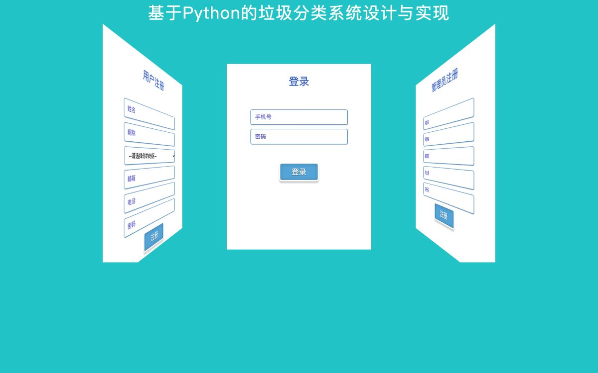
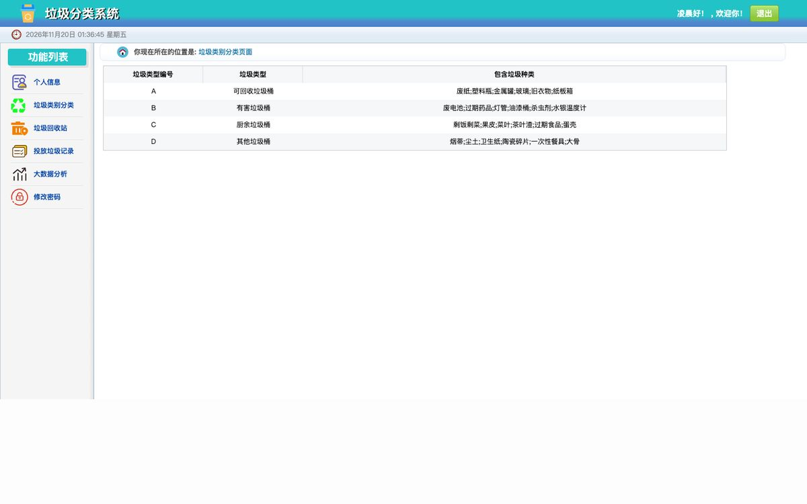
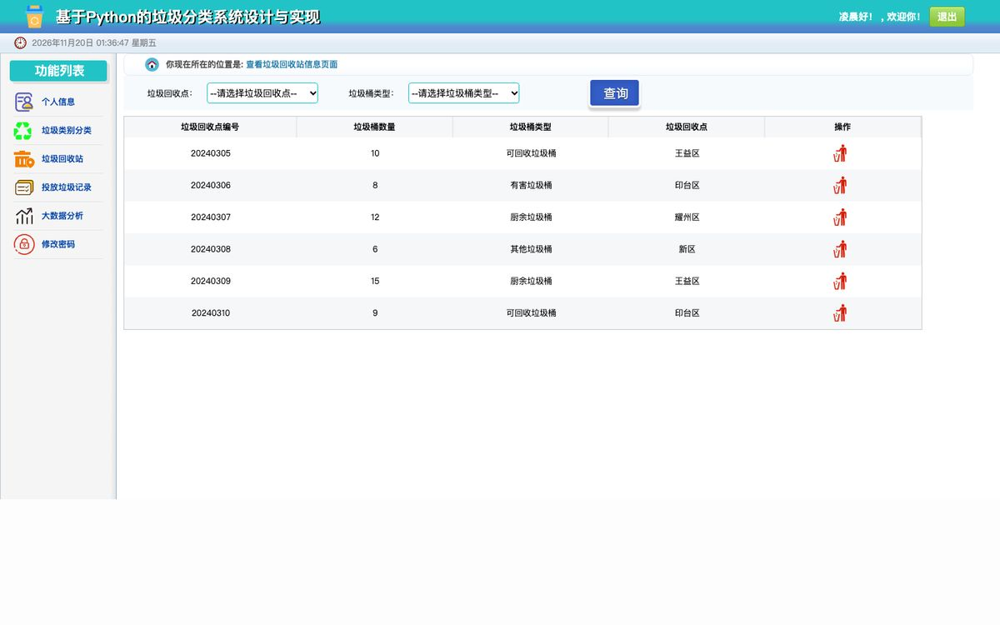
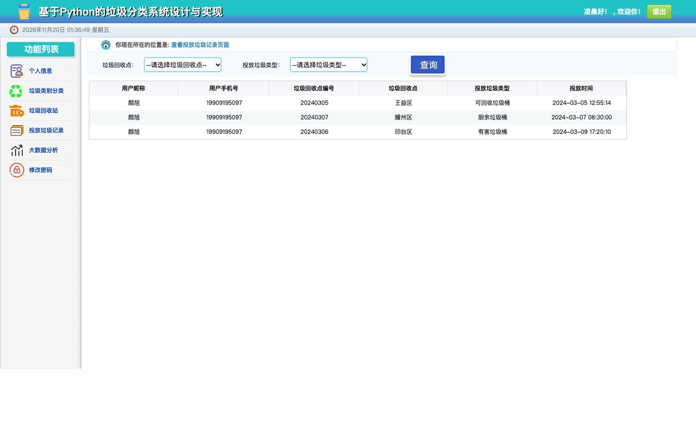
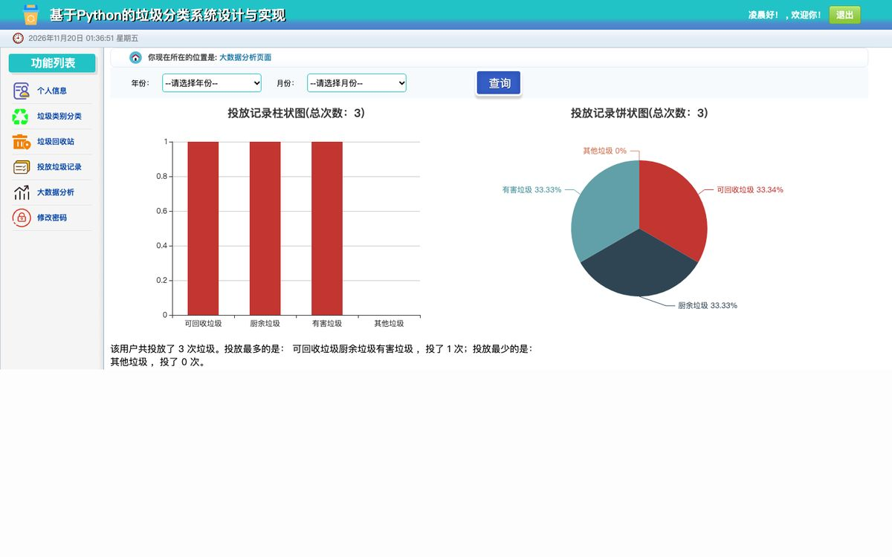
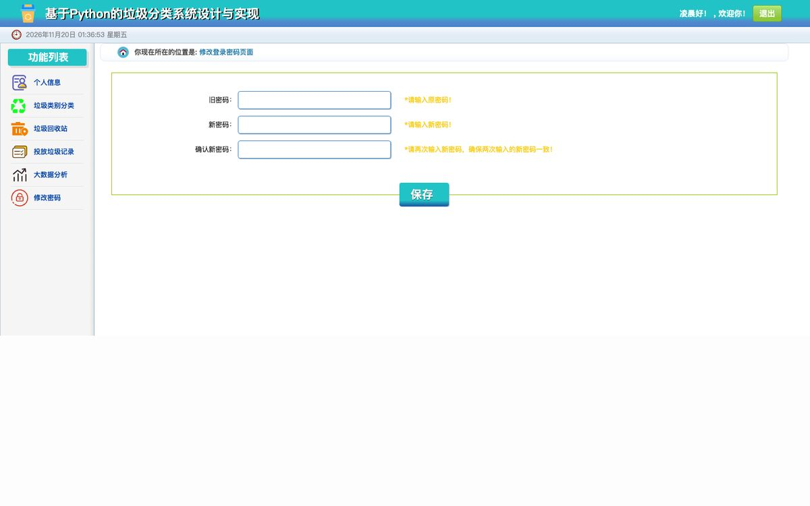
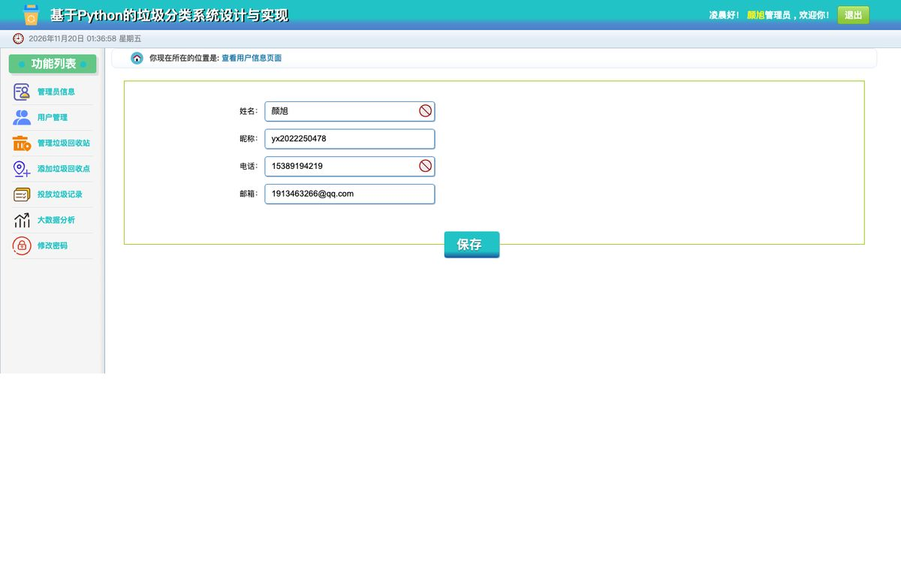
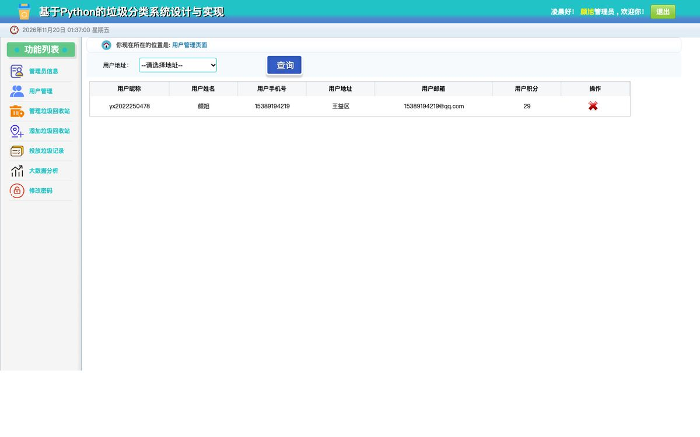
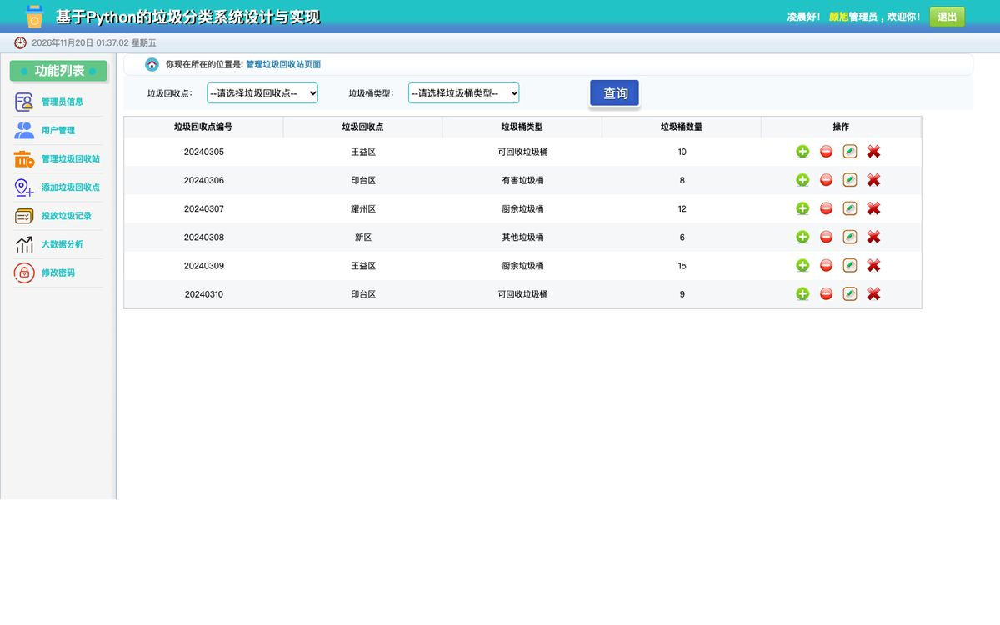
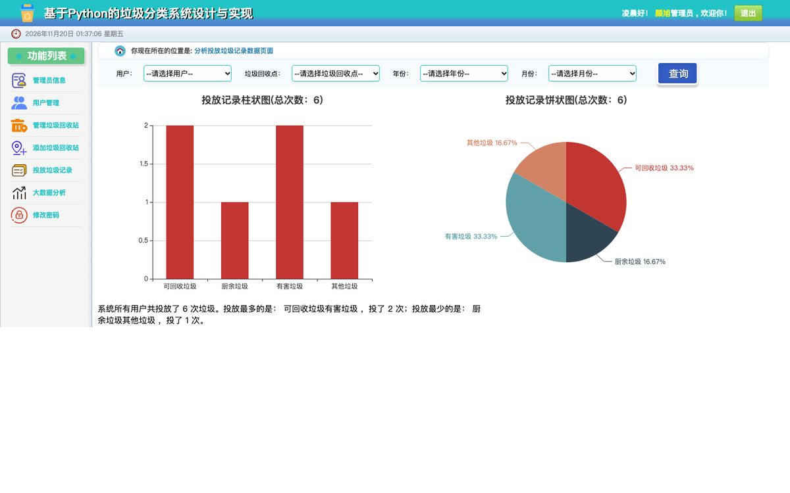

# 垃圾分类管理系统

用 Django 做的一个垃圾分类 Web 系统，给社区居民和后台管理员两边用。居民这边可以查垃圾怎么分类、找附近的回收点、记录自己投放垃圾的情况；管理员在后台维护基础数据、查投放台账、看统计图表。

当初选 Django 主要是因为自带的 Admin 和 ORM 够用，系统本身不复杂：四类垃圾（可回收、有害、厨余、其他）加上回收点两张主表，投放记录把它们串起来。前端用了 Bootstrap 和 jQuery，统计图表用 ECharts 画的。

用户和管理员是分开注册、分开登录的，两边的资料表也是独立的。普通用户登录后能看到自己历次投放的统计，管理员登录后看到的是全局数据——可以按区域、垃圾类型、年月筛选，看哪类垃圾投放最多、哪个回收点最忙，再反过来调整回收点的布置。这个思路其实很简单：以前靠人工登记，投放数据留不下来，现在每一条投放记录都进了数据库，分析就有依据了。

页面截图如下，都是系统本地跑起来的真实界面。

*登录注册：用户和管理员分开注册登录，两边的资料和权限互不干扰。*

*垃圾类别查询：输入垃圾名称就能查到属于哪类、怎么扔，替代翻分类手册。*

*查找回收点：按区域列出附近回收点，居民投放不用再跑空趟。*

*投放记录：每次投放自动记账，以前人工登记数据留不下来，现在每条都进了库。*

*用户统计分析：个人投放量和积分汇总，居民能直观看到自己的参与情况。*

*修改密码：自助修改，不用专门找管理员重置账号。*

*管理员信息：后台管理员的资料维护入口。*

*用户管理：管理员统一增删用户账号、核对信息。*

*回收点管理：回收点的增删改都在后台完成，可以按投放数据随时调整布点。*

*全局数据分析：按区域、垃圾类型、年月筛选投放分布，看哪类垃圾最多、哪个点最忙，反过来指导回收点设置。*
